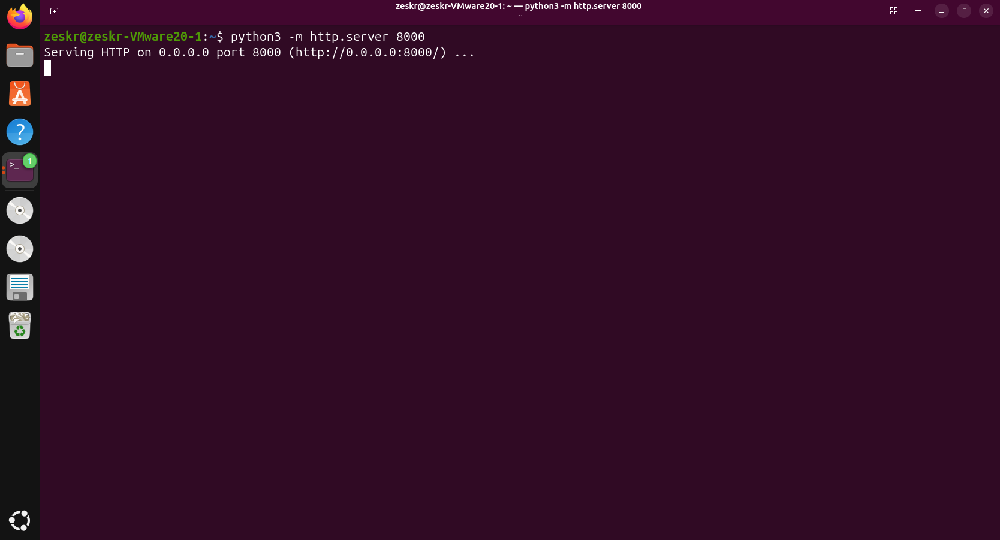
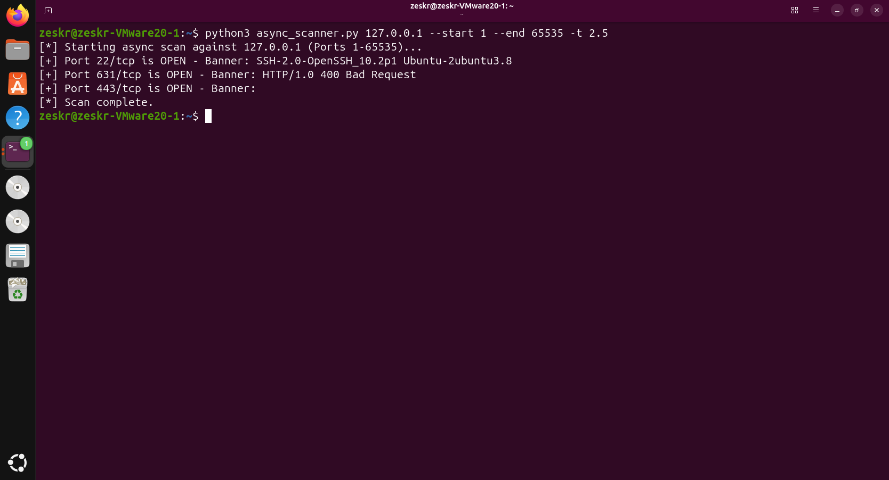

# ⚡ Asynchronous TCP Network Scanner & Banner Grabber

## Overview
A high-performance, custom-built TCP port scanner designed to rapidly identify open network services. Standard iterative scanners are often bottlenecked by network timeouts. By utilizing Python's `asyncio` library, this tool bypasses sequential scanning limitations to perform thousands of simultaneous, non-blocking TCP handshakes, followed by raw socket payload delivery to extract service banners.

## Technical Skills Applied
* **Low-Level Networking:** Deep understanding of the TCP/IP stack and manipulating raw sockets for network reconnaissance.
* **Asynchronous Programming:** Implementing Python `asyncio` to handle concurrent tasks and eliminate I/O blocking during network timeouts.
* **Service Identification:** Programmatically delivering generic `HTTP HEAD` payloads to provoke responses from unknown listening services, demonstrating an understanding of application-layer protocols.
* **Defensive Mindset:** Building tools from scratch to understand how attackers footprint external attack surfaces.

## Installation & Usage

**Prerequisites:** Python 3.x (Uses standard libraries only: `asyncio`, `socket`, `argparse`).

```bash
# Clone the repository
git clone [https://github.com/Zeskr/Async-Network-Scanner.git](https://github.com/Zeskr/Async-Network-Scanner.git)
cd Async-Network-Scanner

# Execute a rapid scan against the loopback interface (Ports 1-65535)
python3 async_scanner.py 127.0.0.1 --start 1 --end 65535 -t 2.5
```

---

## Technical Execution & Proof of Concept

### Phase 1: Target Simulation
To demonstrate the scanner's ability to discover undocumented services, a temporary, lightweight HTTP server was initialized on port 8000. 



### Phase 2: Concurrent Scanning & Banner Extraction
The asynchronous script successfully blasted through all 65,535 possible TCP ports in seconds. It accurately identified the native OpenSSH daemon, the CUPS print server (port 631), and the SSL/TLS service on port 443. Furthermore, it successfully established raw connections to extract the specific software version (e.g., `OpenSSH_10.2p1 Ubuntu-2ubuntu3.8`).


